

Agentic large language model systems are moving from conversational and coding assistants to co-scientists in the molecular sciences, such as planning syntheses, calling domain tools, and closing experimental loops with laboratory automation. Recent demonstrations span autonomous drug repurposing, retrosynthesis, and genome-wide virtual screening, all built on stacks of learned representations, predictors, and simulators. Yet careful benchmarking has exposed striking failures at seemingly simple tasks: tool-augmented agents reach only around 50% accuracy on chemical cost estimation, chemistry language models fail systematic symbolic reasoning on molecular graphs, and single-cell foundation models for perturbation prediction do not outperform linear baselines. This workshop takes the contrast between agentic ambition and methodological fragility as its starting point with explicit space for negative results, rigorous baselines, and benchmark contributions alongside methodological advances.

## Invited Speakers

  

    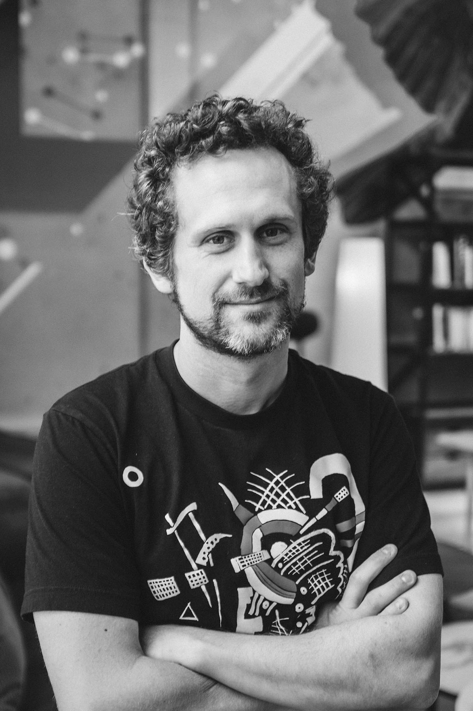
    

      <h3><a href="https://www.futurehouse.org/team/andrew-white">Andrew White</a></h3>
      FutureHouse
      
Co-founder and head of science at FutureHouse; pioneer of agentic AI systems for science (ChemCrow, ether0, PaperQA).

    

  

  

    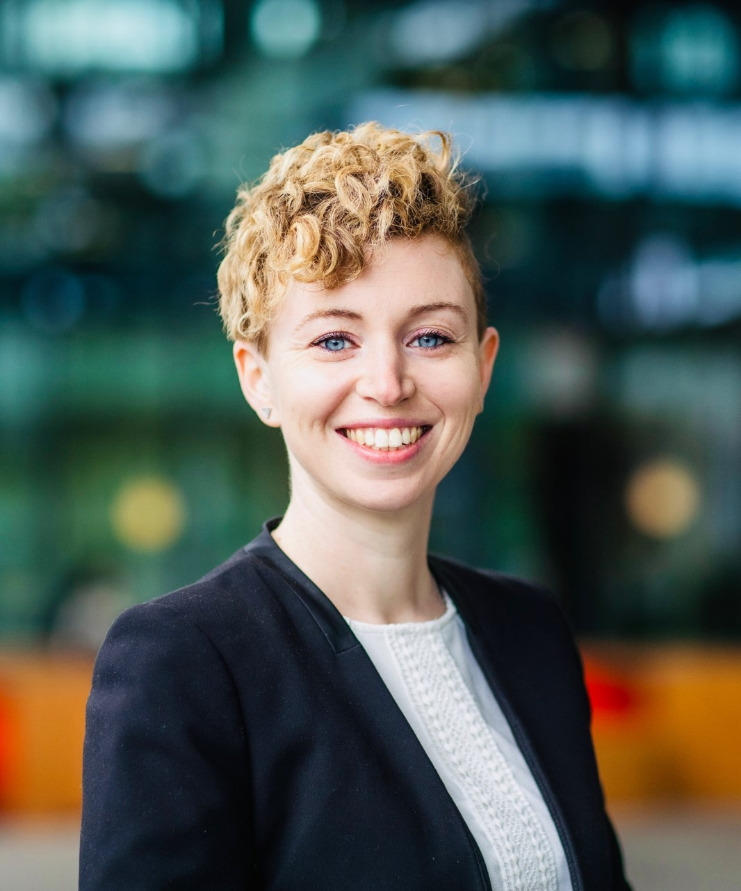
    

      <h3><a href="https://www.tue.nl/en/research/researchers/francesca-grisoni">Francesca Grisoni</a></h3>
      TU Eindhoven
      
Associate Professor leading the Molecular Machine Learning team, bridging AI and the wet-lab for drug discovery.

    

  

  

    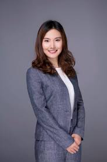
    

      <h3><a href="https://atomlab.yanyanlan.com/lanyanyan/">Yanyan Lan</a></h3>
      Tsinghua University
      
Deputy Dean and professor at the Institute for AI Industry Research (AIR); machine learning, information retrieval, and AI for Science.

    

  

  

    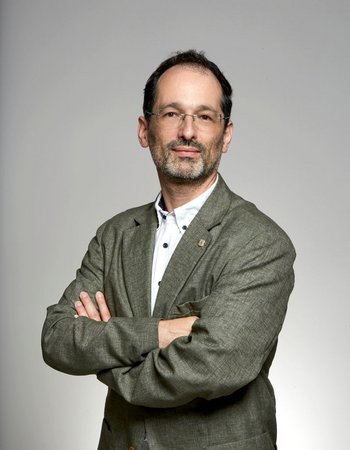
    

      <h3><a href="https://www.eng.cam.ac.uk/profiles/gc121">Gábor Csányi</a></h3>
      University of Cambridge &amp; Max Planck Institute for Polymer Research
      
Pioneer of machine-learning interatomic potentials and first-principles property prediction.

    

  

  

    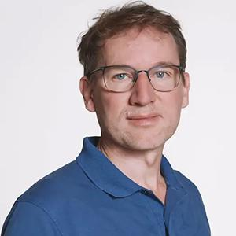
    

      <h3><a href="https://jpvert.github.io/">Jean-Philippe Vert</a></h3>
      Bioptimus
      
Co-founder and CEO of Bioptimus, building foundation models for biology and medicine; member of the French National Academy of Technologies.

    

  

  

    
    

      <h3><a href="https://schwallergroup.github.io/">Philippe Schwaller</a></h3>
      EPFL
      
Assistant Professor leading the Laboratory of Artificial Chemical Intelligence; AI-accelerated synthesis and chemical reasoning.

    

  

## Panelists

  

    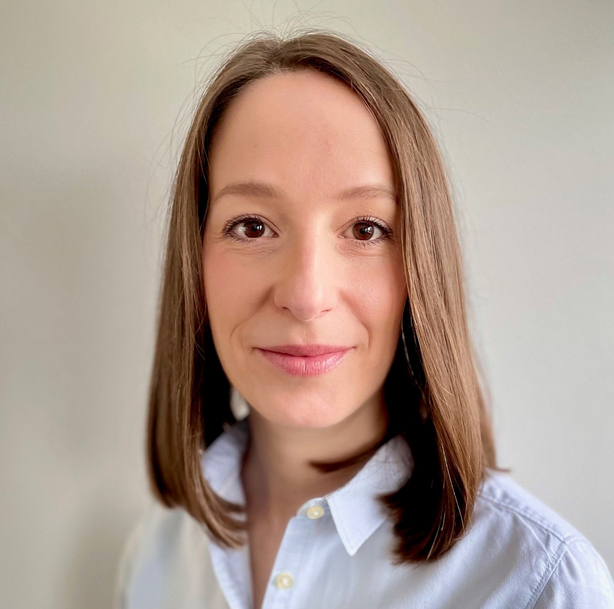
    <h3><a href="https://ellis.eu/person/nadine-schneider">Nadine Schneider</a></h3>
    Novartis (Moderator)
  

  

    
    <h3><a href="https://www.futurehouse.org/team/andrew-white">Andrew White</a></h3>
    FuturHouse
  

  

    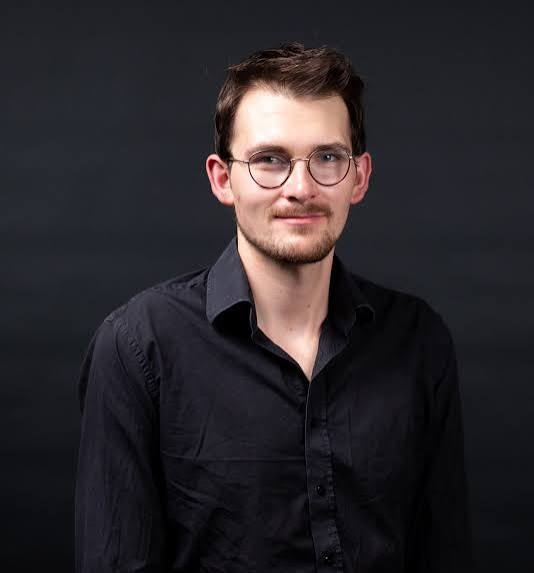
    <h3><a href="https://kjablonka.com/">Kevin Jablonka</a></h3>
    Friedrich Schiller University Jena
  

  

    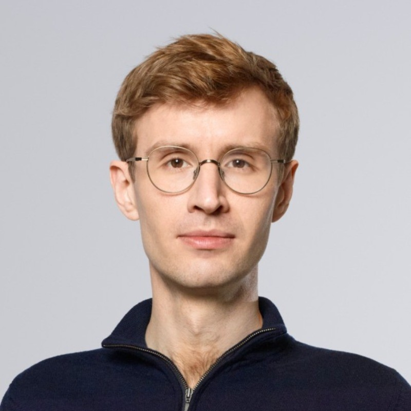
    <h3><a href="https://www.michaelschaarschmidt.com/">Michael Schaarschmidt</a></h3>
    Isomorphic Labs
  

## Organizers

  

    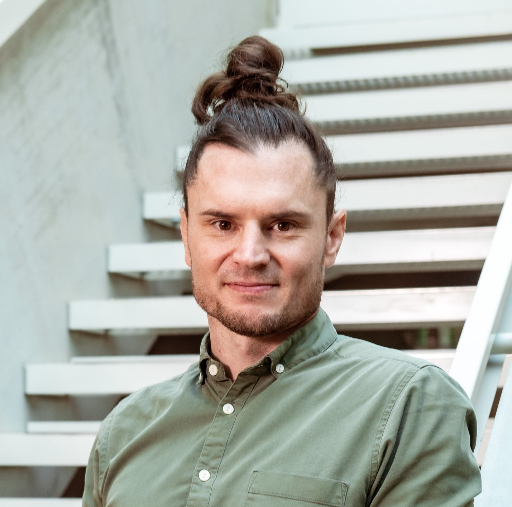
    <h3><a href="https://www.jku.at/en/institute-for-machine-learning/about-us/team/univ-prof-mag-dr-guenter-klambauer/">Günter Klambauer</a></h3>
    ELLIS Unit Linz &amp; Johannes Kepler University Linz
  

  

    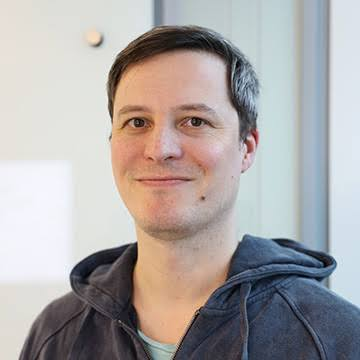
    <h3><a href="https://www.microsoft.com/en-us/research/people/marwinsegler/">Marwin Segler</a></h3>
    Microsoft Research
  

  

    
    <h3><a href="https://ellis.eu/person/nadine-schneider">Nadine Schneider</a></h3>
    Novartis
  

  

    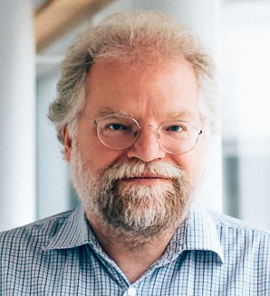
    <h3><a href="https://www.chalmers.se/en/persons/olae/">Ola Engkvist</a></h3>
    AstraZeneca &amp; Chalmers University of Technology
  

  

    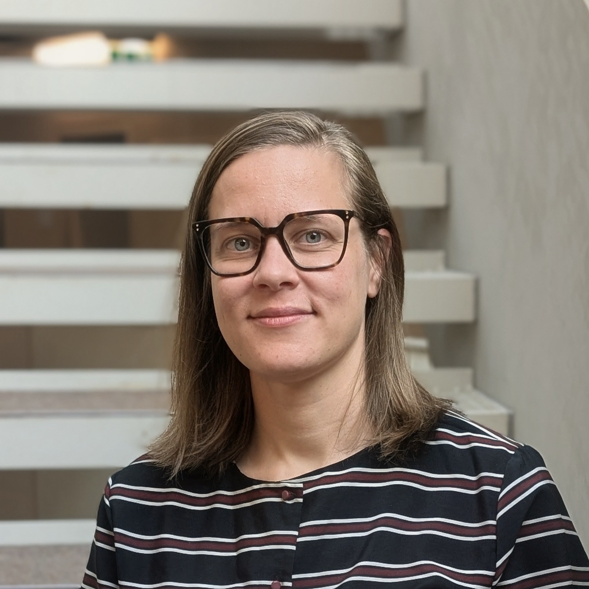
    <h3><a href="https://www.jku.at/en/institute-for-machine-learning/about-us/team/dr-sohvi-luukkonen/">Sohvi Luukkonen</a></h3>
    ELLIS Unit Linz &amp; Johannes Kepler University Linz
  

## Program Committee Chairs

  

    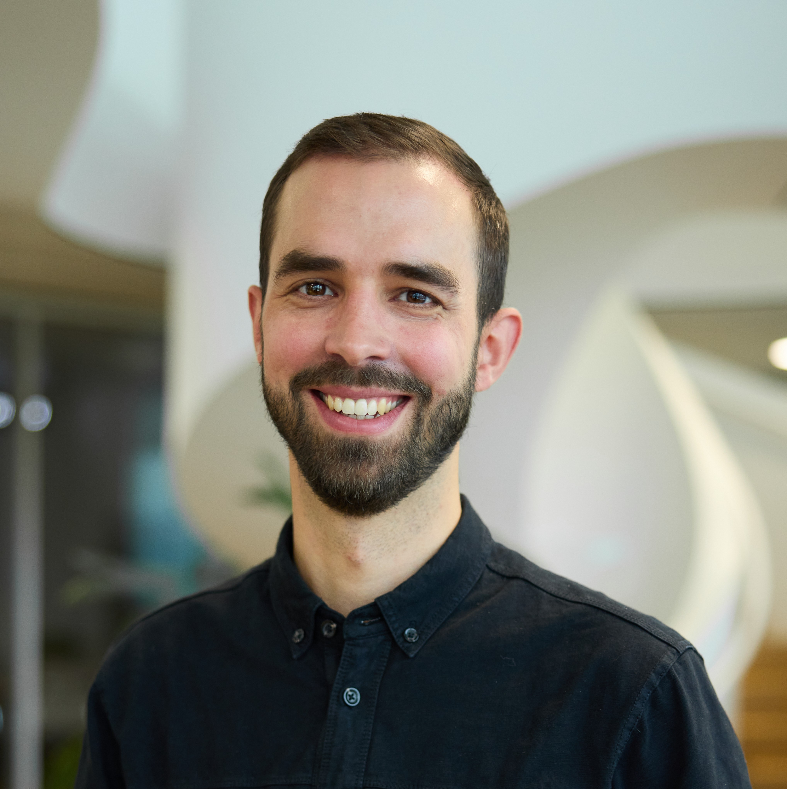
    <h3><a href="https://www.linkedin.com/in/alex-t-m%C3%BCller/">Alex Müller</a></h3>
    Novartis
  

  

    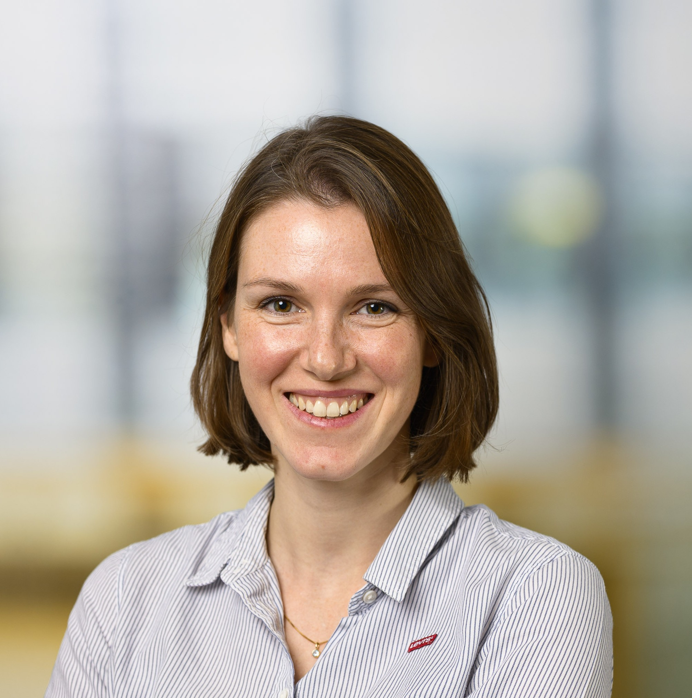
    <h3><a href="https://www.linkedin.com/in/jana-marie-weber-a260081b0/">Jana M. Weber</a></h3>
    Delft University of Technology
  

  

    
    <h3><a href="https://scholar.google.com/citations?user=C7C08CMAAAAJ&amp;hl=en">Jianzhen He</a></h3>
    AstraZeneca
  

  

    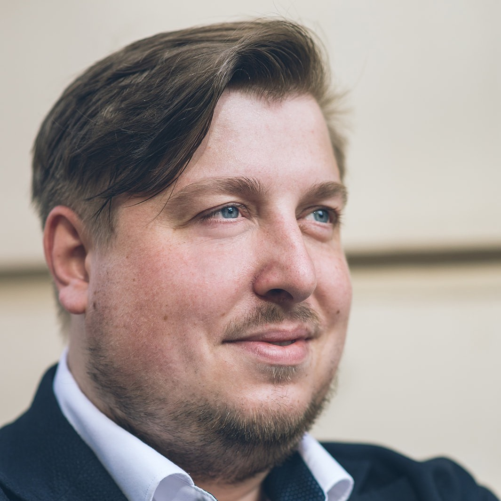
    <h3><a href="https://johannes-schimunek.de/">Johannes Schimunek</a></h3>
    University of Cambridge
  

  

    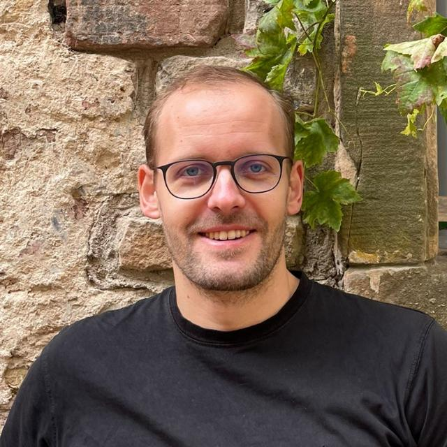
    <h3><a href="https://volkamerlab.org/team/">Michael Backenköhler</a></h3>
    Saarland University
  

<!--
## Preliminary Schedule (subject to changes)

| Time          | Duration | Session                                                                                                                                  |
|---------------|----------|------------------------------------------------------------------------------------------------------------------------------------------|
| 9:00 – 9:10   | 10 min   | **Opening remarks**                                                                        |
| 9:10 – 10:20  | 70 min   | **Block 1**: 2 invited talks (20 min each) + 1 contributed talk (10 min) + **20 min discussion** |
| 10:20 – 10:50 | 30 min   | ☕ **Morning coffee break & posters on display**                                                                                        |
| 10:50 – 12:00 | 70 min   | **Block 2**: 2 invited (20 min) + 1 contributed (10 min) + **20 min discussion**                    |
| 12:00 – 13:00 | 60 min   | 🍽️ **Lunch break & posters on display**                                                                                               |
| 13:00 – 14:10 | 70 min   | **Block 3**: 2 invited (20 min) + 1 contributed (10 min) + **20 min discussion**                         |
| 14:10 – 15:10 | 60 min   | **Block 4**: 1 invited (20 min) + 1 best-paper talk (10 min) + 1 contributed (10 min) + **20 min discussion** |
| 15:10 – 15:40 | 30 min   | ☕ **Afternoon coffee break & posters on display**                                                                                   |
| 15:40 – 16:40 | 60 min   | 🎙️ **Panel discussion**                                            |
| 16:40 – 17:50 | 70 min   | 🖼️ **Dedicated poster session**                                                                                    |
| 17:50 – 18:00 | 10 min   | **Closing remarks**                                                                                          |

-->

## Supporters

The workshop proposal is supported by the [ELLIS unit Linz](https://ellis.eu/research/sites/unit-linz) and the [ELLIS unit Cambridge](https://ellis.eu/research/sites/unit-cambridge).

## Sponsors
Contact us at [ml4molecules@ml.jku.at](mailto:ml4molecules@ml.jku.at) to support this workshop.

## Contact
For questions about the workshop, contact us at [ml4molecules@ml.jku.at](mailto:ml4molecules@ml.jku.at).
